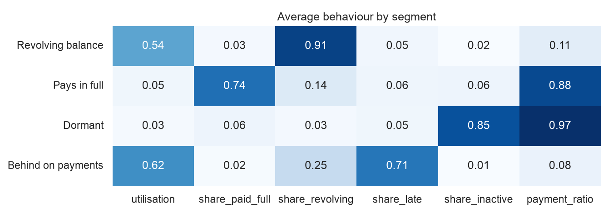
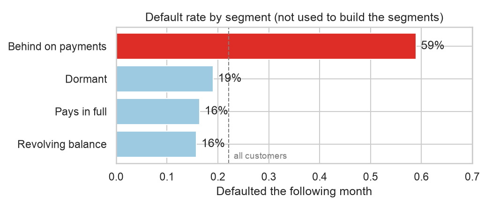
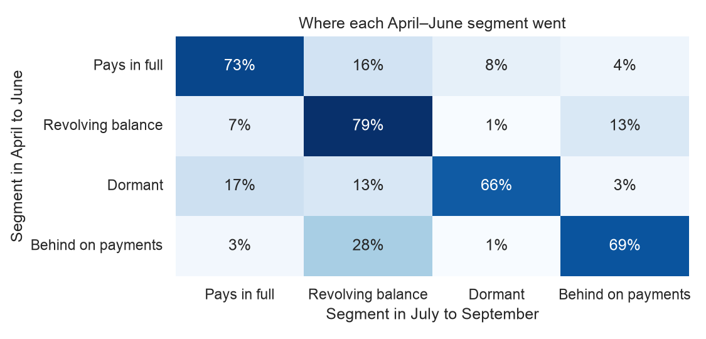
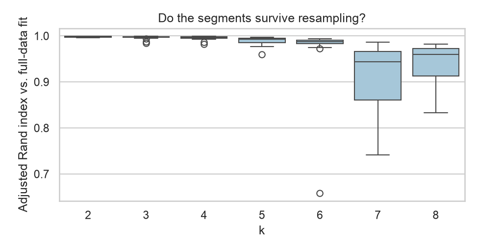

# Credit card customer segments

[](https://github.com/Sammyjoseph999/credit-card-segments/actions/workflows/tests.yml)

Segmenting 30,000 credit card customers by how they use their card, from six months of statements. The segments are built from behaviour only. Whether a customer defaulted the following month is held back, and used at the end to check that the segments mean something.



## Findings

Four segments, all stable and confirmed by a second clustering method:

| Segment | Customers | Behaviour | Default next month |
|---|---|---|---|
| Revolving balance | 51% | Uses half the limit, repays about a tenth of the bill, on time | 16% |
| Pays in full | 22% | Uses a twentieth of the limit and clears it most months | 16% |
| Dormant | 13% | No spending in most months; high, unused limits | 19% |
| Behind on payments | 13% | Smallest limits, late in 71% of months | **59%** |

- **One segment holds the risk.** *Behind on payments* defaults at nearly four times the rate of the others and accounts for 36% of all defaults. The model never saw the default label.
- **The other three differ in how they make money for the issuer, not in risk:** interest from revolvers, fees from transactors, and almost nothing from dormant cards.
- **Dormant customers default slightly more than active ones** despite owing almost nothing, possibly because they have moved their spending to another lender.
- **Segments are not a credit score.** Used to rank customers by risk they reach an ROC AUC of 0.65, against 0.75 for a logistic regression on the same features. They are for deciding what to do with a group, not how risky one customer is.



## Do the segments hold over time?

The same features were built from April to June and from July to September. K-means was fitted on April to June, and July to September customers were assigned with the April–June scaler and centroids.

- **The definitions hold.** A fresh fit on July to September finds the same four segments: adjusted Rand index 0.993 against the carried-forward assignment, with 99.7% of customers in the same segment and matching profiles and names.
- **Customers move.** 75.0% are in the same segment in both quarters. *Behind on payments* grows from 8% to 14% of customers, mostly from revolvers: 2,051 of them (12.5% of revolvers) fell behind, 83.4% of all newcomers to the segment.
- **Newcomers are risky, but less than long-standing members:**

| Behind on payments in… | Customers | Default next month |
|---|---|---|
| both quarters | 1,740 | 68.0% |
| July–September only (moved in) | 2,459 | 48.7% |
| April–June only (caught up) | 800 | 42.0% |
| neither | 25,001 | 15.7% |

A segment from last quarter still describes what kind of customer someone is, but not their current risk. Re-assigning customers each quarter with fixed centroids is enough; refitting is not needed.



## How the segments were checked

- **Number of segments.** Silhouette and Davies-Bouldin scores both pick four from k = 2 to 9.
- **Stability.** K-means was refitted on 20 bootstrap resamples and compared with the full-data fit using the adjusted Rand index. Up to five segments the worst resample still agrees above 0.95; from six, some resamples give a quite different split (as low as 0.66).
- **A second method.** Ward hierarchical clustering on 8,000 customers places 91% of them in the same segment as k-means.



## Features

Raw bill amounts mostly reflect the credit limit, so customers are compared on ratios and shares:

| Feature | Meaning |
|---|---|
| `log_limit` | credit limit, log scale |
| `utilisation` | average bill as a share of the limit |
| `share_inactive`, `share_paid_full`, `share_revolving`, `share_late` | share of the six months in each repayment status |
| `payment_ratio` | total paid over total billed |

Age, sex and education are left out of the clustering. They differ only a little between the segments.

## Layout

```
segments/features.py   statements to behavioural features, for any set of months
segments/cluster.py    choosing k, bootstrap stability, Ward clustering, label matching
segments/profile.py    segment profiles and names
segments/over_time.py  carrying segments into a later period, transitions
notebook.ipynb         the analysis
tests/                 unit tests on small hand-made statements
```

## Data

`data/credit_card_clients.csv`: *Default of Credit Card Clients* (Yeh and Lien, 2009), from the [UCI Machine Learning Repository](https://archive.ics.uci.edu/dataset/350/default+of+credit+card+clients), released under CC BY 4.0. Customers of a Taiwanese card issuer, April to September 2005, amounts in New Taiwan dollars. Converted from the original Excel file without other changes.

## Running it

```bash
pip install -r requirements.txt
jupyter notebook notebook.ipynb
pytest -q
```

## Limits

- One issuer, in 2005, during a period of rising card debt in Taiwan. The overall default rate (22%) is far higher than in most portfolios today.
- Six months is a short history; a dormant customer may simply be between purchases.
- The outcome is default one month ahead, which measures short-term distress rather than lifetime losses.
- The over-time check covers two adjacent quarters only, and repayment status counts months behind, so some of the stability of *Behind on payments* is built into the status code.

## License

The code is released under the [MIT License](LICENSE). The dataset keeps its CC BY 4.0 licence, described above.
